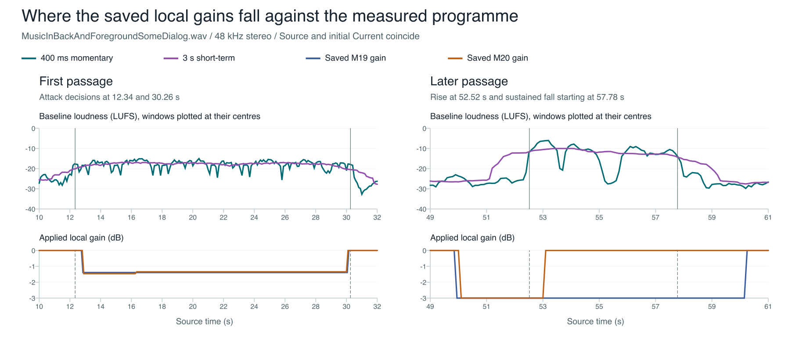

# M20 boundary investigation and proposed rule revision

20 November 2026 · Logic_Implementation_2 · **Decision requested from Strategy**

**Retain a corroborated entrance inside ongoing activity, pair it with its own release evidence, and give that pair one bounded opportunity to reach full-plan comparison.** A tentative interpretation may nominate geometry for explicit review. Automatic recommendation still requires affirmative complete-event coverage and an exact measured pass. Increasing the duration allowance would leave both observed formation failures in place.

On the development recording this exposes two concrete comparisons. The first can put the intended gain in place before the drum attack and hold it through the last comparable hit. The second can concentrate attenuation on the louder middle of a ten-second passage while allowing for the sound after its level drops. The worked examples put the first entry ramp at **12.16–12.26 s** and its return at **30.94–31.04 s** under the explicit margins. For the later passage they put entry at **52.31–52.41 s** and compare returns at **57.98–58.08** and **59.01–59.11 s**. These are frame placements inferred from existing evidence. Their processed sound, compliance and ultimate selection remain open.

## Evidence and coordinate conventions

The input is `MusicInBackAndForegroundSomeDialog.wav`, stereo, 48 kHz, 13,228,800 frames. Its verified SHA-256 begins `7ba6404041c94c90`. Baseline IL is −20.523327 LUFS, TP −0.035708 dBTP and LRA 19.042929 LU. The original and instrumented collectors produced the same event identity in the saved diagnostic. I checked the trace against the production predicates and decoded the hashed core and applied-explanation attachments of both listening sessions. The stored intervals and global gains match the diagnostic summary exactly. The archive contains the existing CSVs, settings, harness and instrumentation recipe. This investigation used those records and performed zero new correction assessments. The listening observations are the user's. [Evidence archive](../../Tests/Qualification/M20Events/results/boundary-investigation-01/trace-evidence.zip) · [Recalculate the energy shares, nominations and returns from the archive](../../Tests/Qualification/M20Events/results/boundary-investigation-01/inspect_evidence.py) · [Source, session and report hashes](../../Tests/Qualification/M20Events/results/boundary-investigation-01/provenance.json)

Three histories matter. The listened-to M19 session uses selective trim. The listened-to M20 uses settings schema 1, inward-only automatic refinement and comparison off. The later Logic experiment uses schema 2 with complete-event preference, comparison on, five frozen roots and, for the detailed trace, an explicitly granted 1 s margin on each side. Its private plan has a different global trim from either saved session. The zero-based CSV root indices are **2 for the first passage and 0 for the later one**. [Experiment report](../../Tests/Qualification/M20Events/results/logic-01/reports/music-margin60.txt) · [Implementation checkpoint](81_M20EventImplementationAndImpact.md)

All intervals below use source frames and half-open ends. A trace row is stamped at the end of a 10 ms cell. Fast and low energies look back 20 and 80 ms respectively. The logged active group and timers are the state immediately before consuming that decision. An attack flag is emitted once per latched episode. Corroboration can arrive in a later cell. For a normal 48 kHz transition the nominal cut is at its centre, the radius is 2,400 frames, and the last of the 4,800 ramp samples already has the destination gain. Times shown for full gain or return use the half-open ramp edge. Percentages and dB values in this report are rounded only for display. [Feature collector](../../Source/Core/Proposal/EventFeatures.cpp) · [Processor geometry](../../Source/Core/Processing/SectionGainPlan.h)

## First passage · entrance, final hit and release

**Detection.** An initial low-band rise produces a tentative onset bracket [482400, 487680), or 10.05–10.16 s. The active group also sees corroboration at 11.59, 11.83 and 12.12 s. Calling the next corroborated attack the first drum hit on that fact alone would be arbitrary. The difference is visible in the level and repetition of the attacks. The table gives dB of the median linear channel-mean fast/low energy over the decision row through decision +100 ms, inclusive, using the same 100 ms reference horizon as the collector. These are auxiliary Source features.

| Attack decision (s) | Fast energy (dB) | Low energy (dB) |
| ---: | ---: | ---: |
| 11.80 | −27.06 | −40.41 |
| 12.07 | −24.31 | −39.91 |
| **12.34** | **−14.59** | **−18.36** |
| 12.86 | −13.83 | −17.44 |
| 13.39 | −13.72 | −17.11 |
| 29.18 / 29.71 | −14.19 / −14.11 | −18.17 / −17.40 |
| **30.26** | **−14.15** | **−16.67** |
| 31.29 | −32.37 | −36.55 |

At 12.34 s (frame 592320) the fast rise has persisted. At 12.37 s (593760) fast and low agree, with contrasts +13.04 and +13.59 dB. The first contributing threshold runs began at 12.32 and 12.33 s. Including their overlapping analysis support gives a **possible new-entrance bracket [12.26, 12.37)**. This is a retrospective bracket, reconstructed from those cells. The production group never stored it. The user's approximate 12.283 s landmark falls inside. The jump in absolute low-band energy and its recurrence distinguish this entrance from earlier rises over a very quiet bed.

**Grouping and ending.** A new attack can create a group only when none is active. The 80 ms upgrade period applies to the group's original entrance. Each subsequent attack replaces its last-attack reference and resets its release evidence. Thus the hit at 12.34 s neither creates a competing entrance nor upgrades 10.05 s. At 30.26 s the attack is already dual-corroborated, with +12.98/+17.98 dB contrast. Its stored last-attack span is [1451520, 1452480), and the cell's raw sample peak is at frame 1452294, about −8.7 dBFS. Its energy resembles the preceding sequence. The drum interpretation is consistent with the user's listening. The trace supplies no instrument label.

The group records an in-decay interval [30.35, 30.55) and an after-decay interval [30.75, 31.05). The former needs a 6 dB fall in fast energy for 200 ms against the last attack reference. The latter needs 300 ms with fast and low energy at or below the opening background plus 3 dB, channel by channel, with a separate floor case. Lower levels qualify. The active group closes at 31.26 s once a second has elapsed since its last attack. Closure time, confirmation of decay, and the frame at which gain may start returning are three different quantities.

**Need and nomination.** The frozen diagnostic threshold for high LRA windows is P10 + 18 = −17.830809 LUFS. The group carries 127 included windows above that value, indices 128–271 with holes. The first spans [12.8, 15.8), centre 14.3. The last spans [27.1, 30.1), centre 28.6. Their connected support supplies the original [12.80, 30.10) analysis hint. Both extreme hits lie outside that union. Treating them would preserve a sequence associated with interior need. Neither hit has a stand-alone LRA deficit. The association in production tests included window **centres** inside the group and original hint. It cannot localise a particular sound inside a 3 s window. [Passage formation](../../Source/Core/Proposal/LraPassages.cpp) · [Association](../../Source/Core/Proposal/EventFeatures.cpp)

The preferred geometry gate requires a need-associated corroborated onset, a supported ending and complete detail. It receives the tentative 10.05 s group. All 16 retained root-2 geometries have the same outer support [614400, 1444800). Internal cuts and gains can vary. An earlier entrance and later release disappear **before prediction**, despite allowed support [566400, 1492800), or [11.80, 31.10). Even promoting the old group would put its start well outside permission. [Nomination and coverage](../../Source/Core/Proposal/EventCoverage.cpp) · [Bounded formation](../../Source/Core/Proposal/RegionFormation.cpp)

**Actual treatment.** In saved M19 the cuts are at 12.80 and 30.10 s, with −1.390 dB between them. The entry ramp is 12.75–12.85 and the return is 30.05–30.15. Saved M20 has nominal cuts at frames 616800, 782400 and 1442400 (12.85, 16.30 and 30.05 s). Its entrance is 12.80–12.90, its two reductions are 1.459 and 1.345 dB, and its return is 30.00–30.10. The user's reading near 12.827 s falls in the transition. Both envelopes miss the first hit and have reached zero local reduction before the last one. Separately applied global gain affects the whole file.

## Later passage · where the 3 s windows put the need

**Association explains the broad M19 region.** There are 74 consecutive included high windows, indices 499–572, centres 51.4–58.7 s in 100 ms steps. The union of their actual 3 s supports is [49.90, 60.20). M19 overlays that union as nominal cuts at frames 2395200 and 2889600. It requests 8.322 dB including reserve and reaches the 3 dB cap. The ramps start at 49.85 and 60.15 s, with return complete at 60.25. This accounts for the user's readings around 49.906–60.196.

The interior of those windows tells a different timing story. In the first high window, [49.9, 52.9), **87.82%** of its K-weighted energy occurs in its last 400 ms. In the last, [57.2, 60.2), **88.18%** occurs in its first 800 ms. Across [50, 60), **97.54%** occurs in [52.4, 58.0), leaving 1.23% on each shoulder. For the first two figures, divide the sum of the contained disjoint momentary-window energy × 0.4 s by that high window's energy × 3 s. For the ten-second figure, tile [50, 60) with 25 disjoint measured 400 ms windows and sum the 14 interior tiles. This is baseline energy localisation. It gives neither a predicted LRA change nor a rule to apply a particular gain.

| Window centre (s) | Momentary, 400 ms (LUFS) | Short-term, 3 s (LUFS) | Interpretation |
| ---: | ---: | ---: | --- |
| 52.3 | −25.55 | −12.19 | Most of the loud activity in the longer window is still ahead |
| 52.8 | −7.44 | −10.84 | Both scales register the rise |
| 55.3 | −27.56 | −11.51 | Brief interior trough between loud passages |
| 57.7 | −12.48 | −13.84 | Strong activity persists near the user's end landmark |
| 58.0 | −23.71 | −15.45 | Local level has fallen while the longer window remains elevated |
| 58.7 | −27.02 | −17.71 | The last qualifying window still contains earlier loud material |

**Detection and grouping.** An earlier tentative group spans onset 47.57–47.60 to decay 50.79–51.09. No high-window centre qualifies inside it, although the first high window overlaps its end. The next tentative group begins at 51.09–51.12 and carries all 74 centres. At 52.52 the collector flags an attack (frame 2520960). At 52.56 fast and low agree (+6.69/+4.68 dB). Low and fast runs began at 52.48 and 52.54. Their conservative support gives [52.41, 52.56). The rise continues sharply. At 52.62, fast energy is −9.5 dB and the raw peak is about −3.2 dBFS at frame 2525522 (52.61504 s). Picking the peak as the entrance would lose the build-up. The 51.09 s group's original upgrade interval has already expired.

At 55.2–55.7 s the momentary level falls and recovers. No evidence here establishes a legal 1 s spared gap with adequate adjoining processing intervals. At 57.76 the mean fast energy is still −13.6 dB. The trace starts a sustained fall at 57.78 and reaches the 200 ms in-decay confirmation at 57.98. Low energy and further activity around 58.17–58.5 complicate the release. The 58.17 attack has a much lower broadband reference (−27.71 dB) than the 57.34 attack (−13.09 dB). Subsequent modest attacks repeatedly reset the single group's decay. Its recorded last attack is 62.48–62.50 and it finishes with a background-return bracket at 62.87–63.17, at the edge of the inspected context. Only 0.70 s separates that last attack from the 63.20 s context edge. The collector finalises the available group at the end of context. Whether the residual belongs with the loud subject, and how long to hold it past 57.762, remain listening questions.

**Nomination and loss.** With no eligible event pair, coarse formation considers persistent differences in median short-term need, their ±1.5 s support alternatives and legal split topologies. Replaying its nomination arithmetic on the recorded window rows gives a rising low-need-run edge at 51.5 and a rising median-change edge at 51.6, each with strength 7.140012 LU. Falling edges at 58.0 and 58.6 have strengths 5.052641 and 5.005921. The coarse builder makes each location and its offsets eligible for either outer edge and adds their unsigned strengths. **50.0 = 51.5 − 1.5 and 53.1 = 51.6 + 1.5.** The winning pair uses two views of the *rise* as both entrance and exit. Its 3.10 s support just fits the 3.00 s nominal minimum plus the two 50 ms offsets. The retained set also has some windows ending at 58.0 or 59.5. The latest retained outer start on root 0 is 51.6. No retained pair starts with the 52.52 attack and follows the second loud portion to its release. Saved M20 places its −3 dB plateau between nominal frames 2402400 and 2546400 (50.05 and 53.05 s), with transitions 50.00–50.10 and 53.00–53.10. This removes part of the quiet lead and stops in the first loud portion. A shorter plan can meet the programme target by changing other roots. Duration alone cannot choose the desired passage.

## Which complete plans were measured

The saved **M19** narrative retains assessment 2 with global −0.964292 dB, IL −23.007214 LUFS, TP −1.000000122 dBTP and LRA 17.389711 LU. **Saved M20** explored 48 proxies and made two assessments. Its first failed IL at −22.799857. The second passed with global −1.637924 dB, IL −22.999932, TP −1.673631 and LRA 17.482816. Both attempts used [50.0, 53.1) on the later root. These exact private results belong to the respective saved plan and requirement binding.

In the later **schema-2, 1 s margin, 60% experiment**, seven groups were frozen and zero met the complete nomination gate. Five roots produced 335 constructions, 39 omitted geometries and 64 distinct evaluated proxies. The beam has width four. It assembles whole local/global plans, compares gains and predicts changes to overlapping window energies and whole-programme gate membership. TP is unknown to this screen. With no supported-complete candidate, scheduling starts with an original-boundary plan and then visits the remaining family. The report identifies these three exact assessments. It does not preserve a score for every pruned branch. [Complete measured report](../../Tests/Qualification/M20Events/results/logic-01/reports/music-margin60.txt) · [Service and scheduler](../../Source/Standalone/StandaloneEventRegionProposal.cpp)

| Attempt | Family and affected time | Forecast IL / LRA | Actual IL / TP / LRA | Exact result |
| --- | --- | --- | --- | --- |
| 1 | Original, 56.1 s | −22.800 / 17.338464 | −22.800164 / −0.717313 / 17.338464 | TP fails |
| 2 | Tighter, 48.9 s | −22.800 / 17.373082 | −22.799898 / −1.385270 / 17.373082 | IL fails by about 0.000102 LU |
| 3 | Same local plan, global lower by 0.2 dB, 48.9 s | −23.000 / 17.373082 | −22.999898 / −1.585270 / 17.373082 | Private pass, known partial + uncertain |

Attempt 3 uses 17.7431% including transitions and zero frames of margin activity. Both passages retain the saved M20 outer supports. The −1.549562 dB global trim and the other roots belong to this experiment. Attempt 3 is the retained display alternative. Recommended and selected attempts are both empty. The existing no-margin 20% and margin 20/40% event experiments likewise require review. The absence of the missing pairs in formation is decisive here. None of these measurements evaluates them. [20% without margins](../../Tests/Qualification/M20Events/results/logic-01/reports/music-event20.txt) · [20% with margins](../../Tests/Qualification/M20Events/results/logic-01/reports/music-margin20.txt) · [40% with margins](../../Tests/Qualification/M20Events/results/logic-01/reports/music-margin40.txt)

For the other three roots in attempt 3, the frozen groups establish a reason to investigate attenuation, with weaker evidence for its placement. Times are outer supports and reductions are positive magnitudes. Their contribution matters to every full-plan comparison.

| Support (s) | Evidence of need and chosen gain | Limit of the explanation |
| --- | --- | --- |
| 78.90–97.60 | 158 qualifying window centres. Reductions 1.526, 1.905 and 1.568 dB, with internal cuts at 82.40 and 94.00 s nominated by changes in measured need. | Tentative entrance and unresolved end. Audition whether the two internal changes are useful. |
| 175.10–180.10 | 10 qualifying centres. Original support retained with a 1.224 dB reduction including the requested reserve. | Tentative group, no confirmed end. Compare keeping this root unchanged. |
| 188.70–193.50 | 19 qualifying centres. Original support retained at 1.278 dB including reserve. | Tentative group, no confirmed end. Compare a shallower reduction and omitting the root. |

## Decision for review

| Change considered | What it recovers | What it can get wrong |
| --- | --- | --- |
| Replace an open group at each distinct entrance | A later attack can supply an onset and a fresh background for release | A fill, pickup, footstep or louder beat can erase a valid earlier entrance. A single replacement still commits too early. |
| Keep a small number of competing interpretations | Compares one continuing passage with an inner louder passage and compares two returns using the same need evidence | Unrestricted combinations grow quickly. Treating two views of one hit as two events would distort coverage. |
| Let tentative pairs nominate a processing region | Gives a legal pair with a clear rationale a route into prediction and exact measurement | Relaxing recommendation confidence at the same time would allow an unresolved ending to appear complete. A tentative parent alone still gives the wrong anchors. |

**Adopt all three mechanisms together, with continuation retained, two interpretations at a time, and unchanged authority for a measured alternative.** This is a change to the accepted feature, formation and scheduling contracts in 80. The change affects what the engine can spend a comparison on. It supplies no new processing permission or delivery tolerance. [Accepted contract](80_M20CompleteEventFinalReview.md)

### Formation rules and initial parameter definitions

1. **Freeze need first.** Keep the existing Current gate, P10 + selected LRA ceiling, original root IDs, ownership and included high-window IDs. A local contender must address measured need in the hint. Require at least one qualifying centre in the proposed subject's extent intersected with the hint, and positive local additional support associated with need under the existing plan check. Context outside the hint may explain the entrance or tail of that subject. For placement, distribute each qualifying window's provisional excess across its real 100 ms Current sidecar bins in proportion to their K-weighted energy within the window. Exclude padded energy from locating a Source event. If a bin is only partly overlapped, identify the within-bin uniform-energy estimate. Keep contributions indexed by window, including overlaps. For ordering two possible subjects in a root, sum the per-window captured fractions weighted by that window's excess, counting each bin once per window and each window once per interpretation. This orders localisation work. The predictive pass still transforms the complete plan and recomputes the populations. A floor-only, missing or stale record supplies no positive evidence.

2. **Allow an entrance inside an open group.** Keep the existing fast/low filters, floor, hop, rise persistence and original-onset corroboration. At each newly latched persistent Source attack, capture its own run starts, decision and confirmation frames, role witnesses, 250 ms preceding background at the attack decision and 100 ms post-attack reference in each band. Reuse the preceding median and the upper median over the reference cells in linear energy. For ranking attacks use the non-LFE channel mean in each band, and retain the role-specific witness so a single-channel event remains explainable. At the first confirming cell, the bracket begins at the earliest real sample that contributed to the confirming runs, and ends at that cell's end. Missing history or disagreement widens uncertainty. A rise confined to Current automation is ineligible as a Source entrance.

   As the first testable definition of a distinct inner entrance, require a corroborated Source episode and a **6 dB increase in either 100 ms band reference over the stronger of the two immediately preceding attack references**, both within the preceding 1 s. Require the median of 400 ms Current windows wholly inside the following second to exceed that for the preceding second by at least **3 LU**, with complete finite data on both sides. For these contextual LUFS medians average the two middle levels when the count is even. Under existing gain transitions disclose any Source/Current disagreement and withhold a supported interpretation until independent Source level context confirms the step. Use the same movement on the witnessing role as a separately labelled tentative path if aggregation masks it. Keep the ordinary entrance-from-floor path when there are no preceding attacks. Six dB reuses the existing broadband rise scale to distinguish an actual change in attack strength. The two preceding references resist a single weak predecessor, and the independent 3 LU level context resists subdividing every beat. These are proposed fixed development values to freeze before listening.

   The 12.34 s reference exceeds the stronger predecessor by **9.72 dB fast and 21.55 dB low**. The neighbouring momentary medians are −23.90 and −19.44 LUFS. At 52.52 s the fast step over 51.91/52.00 is **7.19 dB**, with neighbouring medians −25.80 and −6.40 LUFS. Both examples clear these entry tests. The next drum at 12.86 differs by less than 1 dB in each reference and its adjacent medians differ by 0.74 LU. It can extend the same subject. This evidence distinguishes a change of activity from a series of repeated threshold crossings.

3. **Track continuation and release independently for each interpretation.** Keep the outer group plus one contender for an inner group. Store the onset background and the last comparable activity separately. Use the band that qualified the entry, preferring broadband when both qualify. As an initial continuation rule, accept a later persistent attack whose 100 ms reference in that band is no more than 6 dB below the greater of the opening reference and the upper median of the last three accepted references. A stronger attack can qualify. Keep the winning role consistent for a role-specific hypothesis. Preserve the existing continuing-group interpretation of weaker attacks as a rival. A quieter attack cannot by itself reset every candidate's ending. When the material sustains without attacks, continuous Source fast/low history and momentary level must also be inspected through the proposed release. Missing detail or an elevated/conflicting witness keeps the ending uncertain.

   Keep two exit possibilities. Record the first continuous **6 dB fast-energy fall for 200 ms** after the last comparable attack's reference as an in-decay alternative. Record a separate **300 ms all-channel return to at most opening background +3 dB** in both fast and low energy, using the existing silence predicate. Reset the respective timers on contrary evidence, and reset the provisional endings on a new comparable attack. Keep a return provisional until 1 s has elapsed from the last comparable attack and the return still holds. The upper frame of the confirmed return is the earliest release start for that interpretation. The one-second lookahead can validate an earlier bracket. A 200 ms fall permits review of an earlier return. Continuing low-band energy, reverberation, a sustained new bed, a conflicting channel or an attack during return must remain visible. The opening background can itself be atypical. If the earlier and later interpretations disagree about what is still sounding, preserve that disagreement.

   A level drop inside a phrase is a separate split question. Require frozen sustained need change, the existing minimum interval and separation including both ramps, and allowance for two internal boundaries to spare a middle. Here the brief 55 s trough is a reason to audition the continuous version. The M/S evidence gives no basis for chasing every dip with a new gain change. For gradual entrances or ends without corroborated attacks, keep coarse M/S-based nominations labelled uncertain. Do not infer silence from truncated context, EOF drain, a missing bin or an exhausted record budget.

4. **Freeze rivals before scoring any envelope.** Give every observed attack a stable identity (input/role definition, root and supporting frames). Store each interpretation as references to witnesses, qualifying window IDs/runs, source-frame brackets, confidence and omitted-detail flags. Deduplicate identical witnesses and canonical audio. One outer interpretation plus one inner interpretation may be live per root. Once closed, retain at most one inner pair for formation per root. If candidates compete, order by greater captured high-window excess, then larger entry reference step, then earlier source frame. While an inner group is still open, treat another comparable entrance as continuation. If a genuinely distinct entrance competes for the occupied slot, log truncation and withhold automatic completeness where that conflict matters. Do not silently infer that all other hypotheses failed. Rank closed pairs against the same frozen root data. Pair each retained start only with releases justified against its own reference. For coarse outer alternatives also keep the source transition ID and direction. A change toward higher need can nominate entry, and a change toward lower need can nominate return. Centre and ±1.5 s variants inherit their parent's direction and ID. Treat same-direction median/run edges within one 100 ms nomination step and with overlapping persistence intervals as duplicate evidence for this purpose. Require separate rising and falling evidence for an inferred pair, or record the explicit pin/original edge used on a side. In the later passage this would remove the spurious 50.0–53.1 pair while preserving the original and legitimate falling-edge challengers. Keep the broad context for review when direction is ambiguous.

5. **Separate proposing from certifying.** A legal need-associated inner pair with an observed entrance and either exit can compete even while grouping or release is tentative. Store a family ID distinct from its coverage verdict. A recommended complete pass must meet the existing exact additional-envelope test against every implicated need-bearing or incidental event, with the actual before/after processor, the intended gain schedule and every relevant ramp breakpoint. For mutually exclusive parses, share the physical witness IDs and evaluate each credible parse independently. Require coverage under all unresolved credible parses for automatic complete status. Carry established partial treatment and uncertainty as independent flags. Disagreement that only one parse proves a miss must be attributed to that parse and must at least block automatic recommendation. Definite misses common to the credible parses retain the known-partial flag. Empty signatures, omitted relevant evidence or unexamined incidental material cannot earn a complete preference. A candidate cannot make its own short interpretation definitive. This is an explicit extension of coverage identity and reporting.

### Two worked placements on this recording

These **conditional geometries for review** are calculations on the recorded cells. To reproduce the local return calculation, take the two fast and two low background values from the attack-decision row. For each subsequent 10 ms cell near the ending, test all four recorded channel energies against their respective background × 10^0.3. Count consecutive passing cells from the beginning of the first cell. The background values and intervals below use the full-precision CSV. Later comparable activity, any competing interpretation, the exact envelope and legal settings must still be checked.

| Source evidence | Conditional entry | Conditional return | What the comparison would establish |
| --- | --- | --- | --- |
| First passage, 12.34 s entrance. Opening fast/low background −26.89/−34.96 dB per channel | Ramp [12.16, 12.26), intended gain by frame 588480. This covers the earlier side of the bracket and the user's landmark. | After the 30.26 s hit, all bands stay below this local return threshold from 30.64 through at least 31.26. Confirmation is 30.94. A return [30.94, 31.04) gives support **[583680, 1489920)**. | Both ramps fit the explicit [11.80, 31.10) permission. Under the broad group's later 31.05 confirmation, a full return would end at 31.15, **2,400 frames beyond permission**. Keep that conflict. An in-decay return at 30.55–30.65 could cover the hit and still expose more tail. |
| Later passage, 52.52 s entrance. Opening fast/low background −29.60/−37.99 dB per channel | Ramp [52.31, 52.41), intended gain by frame 2515680. The 52.615 s peak lies inside the treatment. | Following the loud activity, the local return test holds from 58.71 through at least 59.01. A return [59.01, 59.11) gives support **[2510880, 2837280)**. The trace also has a fall from 57.78 through 57.98. Test [57.98, 58.08) as an explicitly earlier release. | The after-return example uses 6.80 s and spares both shoulders of M19. The earlier version uses 5.77 s and exposes more low-band activity. Both fit [48.90, 61.20). The broad group's 63.17 s ending cannot fit there. Listening must determine whether the later residual belongs with the loud passage. |

For scale only, replacing the two outer supports of the archived 48.9 s example with the two longer worked supports would give **54.18 s, or 19.66%**, if the other three disjoint supports stayed fixed. This is duration arithmetic. A changed combination needs fresh construction, gain sizing, prediction and exact assessment. The first worked placement depends on previously granted margins. Under strict automatic bounds its entrance is unavailable. Report the blocked frames and retain the legal original. Neither a boundary clipped to permission nor an earlier release chosen to fit can inherit a complete label.

### Search, cost and authority

| Stage | Proposed allocation and guard |
| --- | --- |
| Features | One verified Source read after assembly and before programme processing, with parallel frozen Current context and the existing 100 ms prediction bins. Retain role-separated fast/low evidence, sample peaks with locations, and the momentary/short-term support IDs. A raw peak describes timing only. Keep 5/10/20 ms supported test cadences, 3 s context, 14 six-second neighbourhoods and 64 summary slots per root. Store constituent IDs/runs compactly. Read the shared frozen measurements by index. LFE has its own context, no authority to create need, and remains in linked processing and all-channel peak checks. |
| Additional storage | Design ceilings of 64 KiB shared rolling scratch (1.2 s × 200 hops/s × 12 roles × 2 bands × 8 bytes = 46,080 bytes before headers), 8 KiB of live state per root × 8, and 128 additional bytes per summary × 64 × 8. Total **192 KiB**. With the recorded worst feature reservation of 9,840,968 bytes this models 10,037,576 within 10 MiB. The previous three-hour-sized simultaneous model of 55,374,952 bytes would become 55,571,560 before additional plan/receipt overhead. Reuse the existing cell array and bounded ID storage. Preflight all simultaneous allocations, strings, per-role state and plan copies against 64 MiB, measure actual high-water, and log unavailable detail or fail explicitly on exhaustion. Fixed-size summaries can reference role/band arrays and contiguous window runs. If the worst case cannot represent the provenance, mark it incomplete. These are estimates. [Measured resource baseline](81_M20EventImplementationAndImpact.md) |
| Formation | Keep 8 roots, 12 nonmandatory locations, 256 constructions and 16 retained geometries per root. Reserve paired coordinates first for supported and inner-after/inner-in-decay geometries, up to **six of the 12** locations, with shared coordinates charged once. Preserve the original and a legal two-cut spared-middle contender, then use remaining slots for ordinary locations/splits. Pins stay mandatory. Count every construction and identify rejected, displaced and omitted pairs. Fixed midpoint ownership, support-edge permissions, protection, minimums and separation apply before prediction and again after canonicalisation. |
| Prediction | Keep beam width 4 and **32 + 16 + 16 = 64** whole-plan proxy evaluations. Seed a multi-root challenger by replacing eligible original geometries with their retained inner pairs in frozen root order, subject to legality at each step. Preserve the other roots where legal. Reserve up to eight of the first 32 slots for this comparison including global variants, after ordinary original and supported-complete seeds. Use two seed geometries at most (after-return, then earlier return). Return unused slots immediately. Preserve one-root add/drop/replace and shallower/deeper alternatives from the existing zero, half, requested, +0.5 dB and headroom choices. Record whether the pair reached the pool and which gains/combinations were pruned. No per-root or per-family restart. |
| Exact scheduling | Retain the maximum of **three** private whole-programme assessments. Keep existing screened-complete-first, one eligible complete-family scalar repair, and original challenger priorities. In the residual tighter/other slot, prefer the best distinct screened need-localised challenger when available. If none screens, order the eligible residual candidates by the existing anchored failed-forecast ranking. State which family a repair or earlier assessment displaced. Screening includes available selected M/S and whole-plan IL/LRA. TP remains unknown until measured. Every changed global or local plan needs its own assessment. |
| Selection | Preserve all exact IL/TP/LRA/selected M/S thresholds. Use the existing complete-pass preservation order, including unsupported internal transitions first. The 0.01 LU anchored failed-LRA shortlist applies only to failure ranking. A measured passing but partial/uncertain challenger enters explicit review. Inspection, recommendation and user selection have separate immutable identities. Apply requires a bound measured result, explicit action while stopped and the matching inspected plan. Apply marks Current unverified. Independently measure Current, then reopen and measure the finalized artifact under its own identity. Historical data cannot reconstruct a live receipt. |

Keep the 20% affected-duration default, 3 dB additional/12 dB cumulative gain caps and 0.5 dB requested reserve inside the caps. Report maximum changed roots/connected components where applicable, frame union including ramps, cumulative support, global trim and count of new internal boundaries separately. Two splits allow two new internal boundaries per original root. A bookkeeping divider over identical audio changes nothing. Reading context, splitting, skipping a root or deduplicating a plan cannot widen permission. Time cost is bounded by one streaming update per role/hop and per active root, constant pending states, and an indexed pass over the eligible window/bin overlaps (at most 30 complete 100 ms bins in an aligned 3 s window, plus edge handling). Use prefix sums or an equivalent bounded sweep for comparing many provisional spans. Avoid rescanning whole-programme windows per attack. Keep cancellation within 1 s, cached planning targets 10/20 s on Sequoia/High Sierra, watchdogs 30/60 s and native p95 ≤100 ms. Benchmark extraction separately.

### Versioning and UI review

Make the new method explicit and opt-in. Proposed allocations, subject to an availability check on the combined base, are settings schema **3**, `event-boundary-features-v2`, `region-formation-v3`, `region-gain-search-v3`, `event-treatment-coverage-v2` and `event-assessment-schedule-v2`. Keep `region-constraints-v2`, `window-energy-proxy-v1`, `candidate-review-rank-v3`, the qualified meter and `section-gain-v1` where their semantics remain identical. Version the evidence grouping/attribution definition and encode the thresholds, lookbacks, channel policy, priority and caps in the settings/evidence digest. Bind the exact Source, frozen Current, input roles/range, old processing, requirements, authorisations, result generation, method and selected attempt. If the measured-result binding format needs new fields, version it explicitly.

For persisted new settings/history, propose document **11** with programme **9**, attachment **4** for the competing explanations, and bounded reference tables inside the established 8 MiB narrative limit and 4/128 MiB core/session limits. Dispatch schemas 1 and 2 and attachments 1–3 through their original definitions. Opening an old session preserves its method, settings and digests. Switching method requires explicit confirmation and invalidates dependent work. Save/Save As must communicate reader compatibility. Keep stale-job, New/Open, cancellation, Undo and pending-edit guards, and independent Current/artifact verification.

UI can extend the existing inspector. For each proposed processing region show **why this region**, **why these edges** and **what gives way if the other interpretation is right**. Show included window supports and the local contribution, Source witnesses and brackets, intended gain, beginning/full/return/zero frames, applied global gain, unresolved tail or incidental event, and the alternative's measurement/authority. Distinguish an organisational section, measured analysis region and proposed/applied processing region. Preserve original annotations, explicit/imported pins, protected local intervals and frozen ownership. Use existing gain-lane and review interactions. Navigating a hypothesis cannot select a different measured plan. [Completed UI contract and checks](/Users/fuzz/.codex/worktrees/a411/LevelScope/Docs/ProjectIndex/83_M20CompleteEventUIIntegration.md)

## Acceptance and small implementation sequence

1. **After review, qualify evidence formation alone.** Preserve the completed UI continuation on the implementation base (handover `832952db`, tested code `8b28348d`). Freeze the above initial definitions before running them. Use the same verified file, original neutral Current, 18 LU job, exact profile and recorded settings. Emit a short ledger showing each trigger, prior/next reference, rejection reason, onset, last comparable hit, both release brackets, associated windows and cap losses. Check 5/10/20 ms cadence, chunking and source-frame mapping. Controls should include repeated equal hits, a quieter pickup followed by a new sound, an isolated click, a sustained rise without attacks, speech over music, a decay with an unrelated trailing sound, an internal trough and clipped context. A method that splits every beat or attributes a Current-only fade to Source fails this stage.

2. **Demonstrate legal, musically relevant geometry on this file.** A retained first-passage alternative must reach its chosen nonzero additional gain by the earliest plausible first-hit frame, hold the intended schedule over the comparable final attack and through its claimed ending, and return within permission. Inspect the actual old/new gain at both hits and throughout transitions. Show any earlier return against the later credible ending. On the later passage, retain a paired alternative covering both loud portions, with less attenuation of the lead and tail than M19 and coverage extending beyond saved M20's premature return. Compare the conservative release with any legal in-decay release. Show the dip and remaining low-band activity. Exact landmark equality is unnecessary. If a candidate is blocked, identify the frame, permission, evidence or search slot responsible. Strict bounds and exact pins must continue to block illegal proposals. A pass elsewhere in the programme does not satisfy either placement check.

3. **Assess complete plans under matched conditions.** Begin with a paired comparison at the ordinary 20% allowance with the same explicitly granted 1 s margins on both methods. Preserve the strict/zero-margin control. Use the archived 60% configuration as a separately labelled diagnostic comparison if needed. Hold requirements, gain caps, reserve, frozen baseline, roots and assessment budget equal within each comparison. Keep original, relevant complete and tighter/tentative candidates, half/requested/deeper reductions, and alternatives that leave out or combine different roots. Log achieved/omitted comparisons. Audit actual IL, TP with channel/location, LRA gates/P10/P95 and selected M/S, forecast error, affected union, per-part gain and every transition. List the purpose of **every** changed region, including the other roots. A measured pass obtained by processing a different region must disclose that choice. If all legal candidates fail, return the measured failure and reason. Keep the exact thresholds and budget.

4. **Listen and decide, then validate frozen rules.** Arrange a coordinated, source-time-aligned comparison on copies of the saved sessions and newly assessed plans, with Source reference, preserved M19/M20 and identifiable but blinded alternatives where practical. Include lead-in, the first attack and its final release, both shoulders of the later passage, its trough, and an uninterrupted whole-plan pass. First compare at the intended delivery gains. A separately labelled monitor-level-matched pass can check whether global loudness biases the preference. Have listeners mark first/last relevant sound, audible late entry, lifted tail, pumping, and any bed/dialogue unnecessarily attenuated before revealing the proposed labels. Record per-passage and overall preferences, disagreements and whether a shallower gain or another root combination explains the preference. Musical acceptance needs a useful first and last treatment and improved later placement **on this recording**. An uncertain measured alternative can be useful by explicit choice. It remains uncertain in history.

   Only after that development result, freeze the definition/digest and run independent stereo and conventional 5.1 material, smooth/quiet/noisy and overlapping material, role-specific/LFE and existing-automation controls. Include a known measured-success fixture with independent Current/export equality and a population gate-crossing case with exact membership changes. The archived gate example retained LRA 7.000000 against 6.7 LU. The cinema example retained LRA 23.562825 against 15 LU and TP −0.815701 against −1 dBTP. Evaluate usefulness, compliance and honest failure separately. Cinema satisfies this regression check when the search respects its limits and the report preserves every actual failed requirement, including an LRA above 15 LU. Run bounded memory/cancellation checks and actual High Sierra/new-method comparisons on the frozen combined build. The prior Intel cross-build and native Logic/UI checks have narrower coverage. [Gate report](../../Tests/Qualification/M20Events/results/logic-01/reports/event-gating.txt) · [Cinema report](../../Tests/Qualification/M20Events/results/logic-01/reports/event-cinema.txt)

The review decision is whether to spend a bounded formation and comparison slot on the inner passage while keeping the current standard for recommendation. Implementation would begin with step 1 after approval. Processor, compliance, future limiter/compressor work and video remain separate capabilities in the shared architecture. [Current assignment](../LogicImplementationCurrentTask.md) · [Logic handover](84_LogicImplementation2Handover.md)
